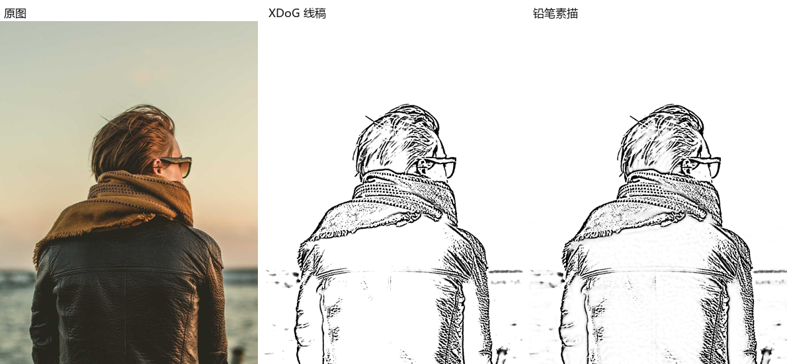
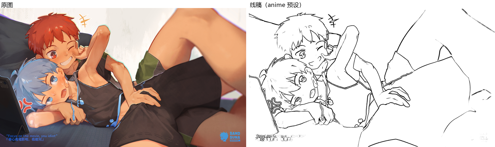
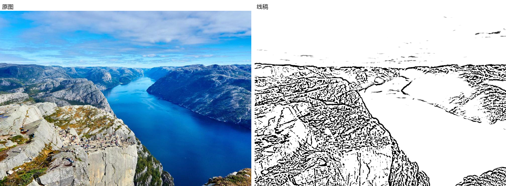

# lineart

把照片、插画转成黑白线稿的命令行工具。Rust 实现，单文件二进制，无外部服务依赖。



## 特性

- **4 种线稿算法**：XDoG（默认，快且连贯）、相干线稿 ETF+FDoG（最连贯）、Canny 细线、铅笔素描
- **保边降噪预处理**：自导向滤波，压掉皮肤、皮革、岩石的纹理杂线，同时不糊真实轮廓
- **分辨率自适应**：`sigma`、降噪半径按长边相对 1920 自动缩放，1080p / 2K / 4K 得到一致的视觉线宽
- **题材预设**：`photo` / `anime` / `ink`，插画预设针对平涂区颗粒做了专门标定
- **多线程**：按行并行（rayon），1920×1091 约 90 ms
- **格式**：输入支持 jpg / png / bmp / webp / tiff 等（由 `image` crate 决定），输出格式按扩展名推断

## 构建

```bash
cargo build --release
# 产物：target/release/lineart（Windows 下为 lineart.exe）
```

## 用法

```bash
lineart <输入图片> <输出图片> [选项]
```

常用示例：

```bash
# 默认 XDoG 线稿
lineart photo.jpg out.png

# 动漫 / 插画
lineart anime.jpg out.png -P anime

# 相干线稿，线条更连续（较慢）
lineart portrait.jpg out.png -m coherent -f 5

# 更干净、更少细节
lineart photo.jpg out.png -d 0.7 -e -0.08

# 清掉碎线，输出纯黑白
lineart photo.jpg out.png --min-area 20 --binarize
```

## 参数

| 选项 | 说明 | 默认 |
| --- | --- | --- |
| `-m, --method` | `xdog` / `coherent` / `canny` / `sketch` | `xdog` |
| `-P, --preset` | `photo` / `anime` / `ink` | `photo` |
| `-s, --sigma` | 线条尺度，越大线越粗 | 随预设 |
| `-k, --k` | DoG 高斯比 | 1.6 |
| `-e, --epsilon` | 线量阈值，取值 `[-0.5, 0]`，越接近 0 线越多 | 随预设 |
| `-p, --phi` | 线条锐度，越大越像墨线 | 随预设 |
| `-d, --denoise` | 保边降噪强度 | 随预设 |
| `-t, --threshold` | Canny 高阈值 | 0.09 |
| `-f, --flow` | `coherent` 沿流平滑 sigma | 4.0 |
| `--min-area` | 删除小于 N 像素的杂线 | 随预设 |
| `--scale` | 处理前缩放，大图可用 0.5 提速 | 1.0 |
| `--binarize` | 输出纯黑白 | 关 |
| `--invert` | 黑底白线 | 关 |
| `-h, --help` | 显示帮助 | - |

预设会给出 `sigma / epsilon / denoise / phi / min-area` 的默认值，单独指定的参数优先：

| 预设 | sigma | epsilon | denoise | phi | min-area | 适用 |
| --- | --- | --- | --- | --- | --- | --- |
| `photo` | 1.4 | -0.05 | 0.45 | 15 | 0 | 照片（默认） |
| `anime` | 1.2 | -0.055 | 0.80 | 15 | 30 | 动漫 / 插画，平涂区颗粒强压 |
| `ink` | 1.0 | -0.03 | 0.15 | 25 | 0 | 干净素材，更细更锐 |

## 算法说明

| 方法 | 原理 | 特点 |
| --- | --- | --- |
| `xdog` | 双尺度高斯差 + tanh 软阈值 | 快、线条连贯，通用默认 |
| `coherent` | 结构张量 ETF 切线场 + 沿流线 FDoG 积分 | 线条最连续，适合人像/主体，约 2 倍耗时 |
| `canny` | 非极大值抑制 + 双阈值滞后 | 1px 细线，偏技术图纸风格 |
| `sketch` | 颜色减淡调子 + XDoG 线条压暗 | 铅笔素描，背景保持纯白 |

关键实现细节：

- DoG 响应用 **99 分位有符号归一化** `u = DoG / p99(|DoG|)`，平坦区 DoG=0 恒为白，`epsilon ≤ 0` 时不会整片变黑
- `epsilon` 越负，只有越强的边缘才能成线；`phi` 控制 tanh 过渡的陡峭程度
- 降噪用自导向滤波（box 均值近似，O(1)/像素），半径与阈值随 `--denoise` 与分辨率缩放

### 插画预设是怎么定的

插画的杂点和照片不同：它几乎全在**平涂区**，是 JPEG 颗粒、网点抖动、笔刷纹理，幅度低、分布散。评价这类输出不能只看「脏不脏」，得同时看「线在不在」。所以把原图分成两类区域来打分：

- **笔画区**：原图局部梯度强且像素本身偏暗——这里本该有线，墨量越高越好
- **平坦区**：梯度平缓、离笔画较远——这里本该留白，墨量越低越好

在 3175×1805 的插画上扫描 `denoise × epsilon × min-area`：

| 配置 | 平坦区墨量 | 笔画区墨量 | 比值 |
| --- | --- | --- | --- |
| 旧默认（`-d 0.30 -e -0.045`） | 0.0219 | 0.6383 | 29 |
| `-d 0.60 -e -0.055 --min-area 30` | 0.0127 | 0.6369 | 50 |
| **`-d 0.80 -e -0.055 --min-area 30`** | **0.0120** | **0.6371** | **53** |
| `-d 0.80 -e -0.065 --min-area 30` | 0.0102 | 0.6348 | 62 |

结论是**在源头压噪**远比事后删线划算：强保边降噪让 DoG 在平涂区根本不起响应，`min-area` 再清掉残渣，两步都不碰线条本身。取 `-e -0.055` 是因为再往负走，笔画区墨量开始掉——那是真实细节在流失。

最终 `anime` 预设：`sigma 1.2 / epsilon -0.055 / denoise 0.80 / phi 15 / min-area 30`。相对旧默认，平坦区杂点 −45%，笔画区墨量 −0.2%（视觉上无差别），线稿平均连续段长从 1043px 涨到 2388px。

### 为什么没有做「用原图引导降噪」

试过，删掉了。思路是：拿原图算「这里该不该有线」的许可图（多尺度黑顶帽 + 跨通道梯度），乘到已经生成的线稿上。插画实测（1920×1091）是**净负作用**：

| 输出 | 平坦区墨量 | 笔画区墨量 | 平均连续段长 |
| --- | --- | --- | --- |
| 基线 | 0.0137 | 0.5291 | 580px |
| 引导降噪 `--strength 0.6` | 0.0052 | 0.4812 | 357px |

杂点确实少了，但**线条被打断成虚线**，段长腰斩。原因在结构上，不是调参能救的：

1. XDoG 输出的线比原图那条线宽 1~2px 且有偏移，任何逐像素许可图都会在笔画边缘对不齐
2. 一旦某处许可掉下去，线就在那里断开——逐像素权重必然制造虚线
3. 单尺度顶帽只对特定宽度的线有响应，粗线的中心反而被挖空

改成「按连通块整体去留」后不再断线（段长回到 634px），但几乎什么也删不掉——因为插画噪声是低幅度细颗粒，和「浅色细线」在原图上完全同构，结构先验没有可分的信息。既然拿不到信号，就不该留着这个开关。

## 效果

| 动漫 / 插画（`-P anime`） | 风景 |
| --- | --- |
|  |  |

## 分辨率自适应

`sigma`、降噪半径、`--flow`、`--min-area` 本质都是像素单位。若不做归一化，同一套参数放到 4K 图上，线会变得细碎、背景出现点状噪点。

因此程序按 `res = clamp(长边 / 1920, 0.3, 4.0)` 对上述像素量统一缩放，`--min-area` 按 `res²` 缩放。1920 宽的输入 `res = 1.0`，行为与朴素实现完全一致。

## 已知局限

- 半透明水印、字幕、渐变叠加边缘都是图像中真实存在的边缘，算法会如实描出，需要 `--min-area` 或后期手动清理
- 岩石、树叶等高频纹理本身细节极多，线稿看起来会偏"密"，可加大 `-s` 与 `-d`
- `sketch` 模式采用颜色减淡算法，在纯色块插画上偏淡，照片效果更好
- `anime` 预设的强降噪会一并压掉极淡的浅灰细纹（如半透明网点、很轻的铅笔草稿线），需要时用 `-d 0.5` 回调

## 项目结构

```
lineart/
├── src/
│   ├── main.rs      CLI 解析、分辨率归一化、流程编排
│   ├── blur.rs      高斯 / box / 导向滤波、Sobel、双线性采样
│   ├── methods.rs   XDoG、相干线稿、Canny、铅笔素描
│   └── post.rs      碎线连通块清理
├── docs/images/     演示与对比图
├── samples/         本地测试素材（已 gitignore）
└── Cargo.toml
```
