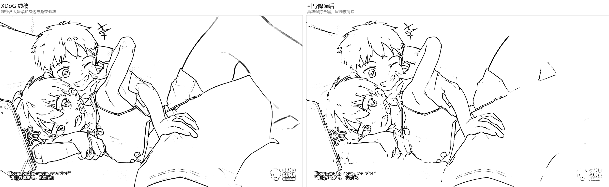

# lineart

把照片、插画转成黑白线稿的命令行工具。Rust 实现，单文件二进制，无外部服务依赖。


## 特性

- **4 种线稿算法**：XDoG（默认，快且连贯）、相干线稿 ETF+FDoG（最连贯）、Canny 细线、铅笔素描
- **引导降噪**：拿原图当结构先验，清理「已经生成好的」线稿里的伪线，插画场景可去掉一半以上的假线且不损真线
- **保边降噪预处理**：自导向滤波，压掉皮肤、皮革、岩石的纹理杂线，同时不糊真实轮廓
- **分辨率自适应**：`sigma`、降噪半径按长边相对 1920 自动缩放，1080p / 2K / 4K 得到一致的视觉线宽
- **题材预设**：`photo` / `anime` / `ink`，单参数仍可覆盖预设
- **多线程**：按行并行（rayon），1920×1091 约 90 ms
- **格式**：输入支持 jpg / png / bmp / webp / tiff 等（由 `image` crate 决定），输出格式按扩展名推断

## 构建

```bash
cargo build --release
# 产物：target/release/lineart（Windows 下为 lineart.exe）
```

## 用法

```bash
lineart <输入图片> <输出图片> [选项]
```

常用示例：

```bash
# 默认 XDoG 线稿
lineart photo.jpg out.png

# 动漫 / 插画
lineart anime.jpg out.png -P anime

# 相干线稿，线条更连续（较慢）
lineart portrait.jpg out.png -m coherent -f 5

# 更干净、更少细节
lineart photo.jpg out.png -d 0.7 -e -0.08

# 清掉碎线，输出纯黑白
lineart photo.jpg out.png --min-area 20 --binarize
```

### 引导降噪（清理已有线稿）

输入改成「待清理的线稿」，`--guide` 指向原图：

```bash
# 先用 XDoG 出图，再引导降噪
lineart anime.jpg line.png -P anime
lineart line.png clean.png --guide anime.jpg --strength 0.6
```

插画对比（左：XDoG 原始，右：引导降噪）：



## 参数

| 选项 | 说明 | 默认 |
| --- | --- | --- |
| `-m, --method` | `xdog` / `coherent` / `canny` / `sketch` | `xdog` |
| `-P, --preset` | `photo` / `anime` / `ink` | `photo` |
| `-s, --sigma` | 线条尺度，越大线越粗 | 1.4 |
| `-k, --k` | DoG 高斯比 | 1.6 |
| `-e, --epsilon` | 线量阈值，取值 `[-0.5, 0]`，越接近 0 线越多 | -0.05 |
| `-p, --phi` | 线条锐度，越大越像墨线 | 15 |
| `-d, --denoise` | 保边降噪强度 | 0.45 |
| `-t, --threshold` | Canny 高阈值 | 0.09 |
| `-f, --flow` | `coherent` 沿流平滑 sigma | 4.0 |
| `--min-area` | 删除小于 N 像素的杂线 | 0 |
| `--scale` | 处理前缩放，大图可用 0.5 提速 | 1.0 |
| `--binarize` | 输出纯黑白 | 关 |
| `--invert` | 黑底白线 | 关 |
| `-g, --guide` | 原图路径，开启引导降噪模式 | 关 |
| `--strength` | 引导降噪强度 `[0,1]`，越大越激进 | 0.5 |
| `-h, --help` | 显示帮助 | - |

预设会给出 `sigma / epsilon / denoise / phi` 的默认值，单独指定的参数优先：

| 预设 | sigma | epsilon | denoise | phi | 适用 |
| --- | --- | --- | --- | --- | --- |
| `photo` | 1.4 | -0.05 | 0.45 | 15 | 照片（默认） |
| `anime` | 1.2 | -0.045 | 0.30 | 15 | 动漫 / 插画，细节更多 |
| `ink` | 1.0 | -0.03 | 0.15 | 25 | 干净素材，更细更锐 |

## 算法说明

| 方法 | 原理 | 特点 |
| --- | --- | --- |
| `xdog` | 双尺度高斯差 + tanh 软阈值 | 快、线条连贯，通用默认 |
| `coherent` | 结构张量 ETF 切线场 + 沿流线 FDoG 积分 | 线条最连续，适合人像/主体，约 2 倍耗时 |
| `canny` | 非极大值抑制 + 双阈值滞后 | 1px 细线，偏技术图纸风格 |
| `sketch` | 颜色减淡调子 + XDoG 线条压暗 | 铅笔素描，背景保持纯白 |

关键实现细节：

- DoG 响应用 **99 分位有符号归一化** `u = DoG / p99(|DoG|)`，平坦区 DoG=0 恒为白，`epsilon ≤ 0` 时不会整片变黑
- `epsilon` 越负，只有越强的边缘才能成线；`phi` 控制 tanh 过渡的陡峭程度
- 降噪用自导向滤波（box 均值近似，O(1)/像素），半径与阈值随 `--denoise` 与分辨率缩放

### 引导降噪原理

线稿的伪线分两类：**平涂/渐变区的抖点**，以及**柔和过渡被当成边缘**。它们有一个共同点——原图在该处不存在「细的深色笔画」或「颜色阶跃」。所以用原图当证据，逐像素判断「这里该不该有线条」。

两条证据取最大，互为补充：

| 证据 | 做法 | 抓得到 | 抓不到 |
| --- | --- | --- | --- |
| 黑顶帽 | 亮度闭运算 − 亮度，响应比结构元细的暗结构 | 插画里画师画的线、发丝、睫毛 | 浅色线、亮暗反转 |
| 彩色阶跃 | RGB 三通道梯度取最大 | 色块交界、亮暗反转的边 | 低对比的浅沟 |

得到的许可权重再经 `smoothstep(0.28, 0.55)` **锐化**——这一步很关键：不做锐化的话，权重会在 0.5 附近徘徊，整幅线稿被乘成灰的；锐化后线条要么保持全黑，要么彻底消失，视觉上才是「干净」而不是「变淡」。

最后清一遍孤立墨点（邻域墨点少于 2 个即删除）。

插画实测（1920×1091，`--strength 0.5`，134 ms）：

| 区域 | XDoG 墨量 | 降噪后 | 变化 |
| --- | --- | --- | --- |
| 笔画处（顶帽强响应） | 0.814 | 0.814 | 0 |
| 非笔画区 | 0.0279 | 0.0142 | −49% |
| 全图 | 0.0579 | 0.0431 | −26% |

也就是说：**假线砍掉近一半，真线一个像素没动**。

## 效果

| 动漫 / 插画（`-P anime`） | 风景 |
| --- | --- |
|  |  |

## 分辨率自适应

`sigma`、降噪半径、`--flow`、`--min-area` 本质都是像素单位。若不做归一化，同一套参数放到 4K 图上，线会变得细碎、背景出现点状噪点。

因此程序按 `res = clamp(长边 / 1920, 0.3, 4.0)` 对上述像素量统一缩放，`--min-area` 按 `res²` 缩放。1920 宽的输入 `res = 1.0`，行为与朴素实现完全一致。

## 已知局限

- 半透明水印、字幕、渐变叠加边缘都是图像中真实存在的边缘，算法会如实描出，需要 `--min-area` 或后期手动清理
- 岩石、树叶等高频纹理本身细节极多，线稿看起来会偏"密"，可加大 `-s` 与 `-d`
- `sketch` 模式采用颜色减淡算法，在纯色块插画上偏淡，照片效果更好
- 引导降噪只认「深色细笔画」与「颜色阶跃」，因此极淡的浅灰线条、低对比度细纹会被一并清掉；这是有意取舍，调低 `--strength` 可保留更多

## 项目结构

```
lineart/
├── src/
│   ├── main.rs      CLI 解析、分辨率归一化、流程编排
│   ├── blur.rs      高斯 / box / 导向滤波、Sobel、双线性采样
│   ├── methods.rs   XDoG、相干线稿、Canny、铅笔素描
│   ├── guide.rs     引导降噪：黑顶帽 + 彩色阶跃门控
│   └── post.rs      碎线连通块清理
├── docs/images/     演示与对比图
├── samples/         本地测试素材（已 gitignore）
└── Cargo.toml
```
